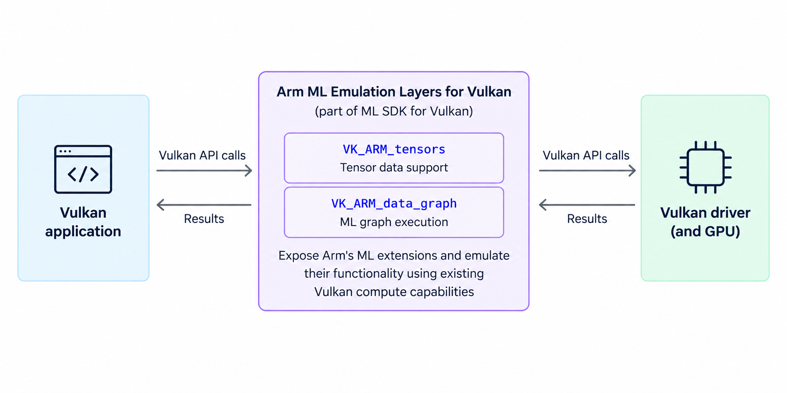

## What is neural graphics, and why does it matter for real-time rendering?

Neural graphics combines real-time rendering with machine learning to improve visual quality and performance. Integrating ML techniques, such as neural upscaling, directly into the GPU pipeline can improve visual fidelity and efficiency. This approach is especially valuable on mobile and embedded devices, where power efficiency is critical.

## How do ML Extensions for Vulkan support neural graphics workloads?

Vulkan extensions add functionality to the Vulkan API. Arm's ML Extensions for Vulkan introduce support for tensor processing and machine learning data graphs.

To make these extensions available on Vulkan-capable hardware that does not support them natively, Arm provides **ML Emulation Layers for Vulkan**, part of the [ML SDK for Vulkan](https://arm.github.io/ai-ml-sdk-for-vulkan/). A Vulkan layer is a software component that sits between a Vulkan application and the Vulkan driver. The ML Emulation Layers expose Arm's ML extensions and emulate their functionality using existing Vulkan compute capabilities.

The `VK_ARM_tensors` extension introduces support for multidimensional tensor data in Vulkan, while `VK_ARM_data_graph` enables the execution of ML computational graphs using Vulkan data graph pipelines. These pipelines use SPIR-V, Vulkan's intermediate representation for GPU programs, to define and execute ML computational graphs.

To help developers adopt these features, the Tensor and Data Graph Vulkan Samples offer hands-on demonstrations.

These samples address key challenges in ML integration, such as:

- **Understanding graph-based compute with Vulkan**: See how compute workloads can be structured using explicit graph topologies.
- **Demystifying ML inference in real-time rendering**: Learn how ML fits into the graphics pipeline.

The samples range from basic configurations to more advanced features, such as tensor aliasing and compute shader integration.

This Learning Path walks you through setting up and running the first sample, `simple_tensor_and_data_graph`.

## Why use ML Extensions for Vulkan in game and graphics development?

As a game developer, you've probably noticed the rising demand for smarter, more immersive graphics — but also the increasing strain on GPU resources, especially on mobile. Vulkan's traditional pipelines give you fine-grained control, but finding the right tooling to integrate machine learning has been a challenge. That’s where the new ML extensions for Vulkan come in.

Instead of coordinating individual compute shaders to implement ML workloads, developers can express computations as dataflow graphs in SPIR-V. This provides a more structured approach to integrating machine learning alongside traditional Vulkan graphics workloads and creates opportunities for graph-level optimization.

Although ML is widely used for image classification and large language models (LLMs), these extensions are particularly useful for game and graphics workloads. They prioritize predictable execution, GPU compatibility, and memory efficiency. Built-in support for tensor formats and pipeline sessions helps you combine traditional Vulkan rendering with machine learning.

## What's next?

For an example of neural graphics in practice, see the Learning Path [**Neural Super Sampling with Unreal Engine**](/learning-paths/mobile-graphics-and-gaming/nss-unreal/).

Continue to the next section to install and configure the ML Emulation Layers for Vulkan, then build and run the Vulkan Samples.
