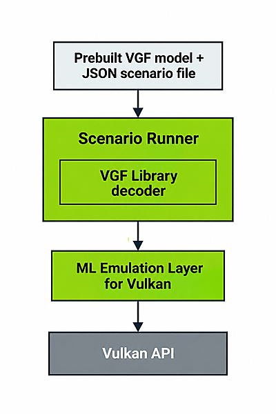

## Overview

You've already configured your Vulkan development environment and run the Simple Tensor and Data Graph sample using the ML Emulation Layers.

In this section, you'll use **Scenario Runner**, a tool from Arm's ML SDK for Vulkan, to execute a prebuilt Neural Super Sampling (NSS) workload and verify its output.

## Scenario Runner in the ML SDK for Vulkan

Arm's ML SDK for Vulkan provides tools and libraries for preparing and executing ML workloads. You've already installed and configured the ML Emulation Layers, one of the SDK components.

The following table summarizes the main SDK components and their roles.


| Component        | Description                                                                                          | Usage context                       | GitHub link |
|------------------|------------------------------------------------------------------------------------------------------|-------------------------------------|--------------|
| **Model Converter** | Converts TOSA IR into SPIR-V graphs and packages them into `.vgf` files for runtime execution.      | Deploy models through asset pipelines | https://github.com/arm/ai-ml-sdk-model-converter |
| **VGF Library**      | Lightweight runtime decoder for `.vgf` files containing graphs, constants, and shaders.              | Load and use graphs in a game engine | https://github.com/arm/ai-ml-sdk-vgf-library |
| **Scenario Runner** | Executes ML workloads declaratively using JSON-based scenario descriptions.                         | Prototype and validate workloads | https://github.com/arm/ai-ml-sdk-scenario-runner |
| **Emulation Layer** | Vulkan layer that emulates data graph and tensor extensions using compute shaders.                      | Test on devices without native support for ML Extensions for Vulkan | https://github.com/arm/ai-ml-emulation-layer-for-vulkan |
| **ML Workload Library for Vulkan** | C++ library for creating and executing ML workloads using Vulkan. | Integrate ML workloads into Vulkan applications | https://github.com/arm/ai-ml-workload-library-for-vulkan |

Vulkan Graph Format (VGF) is a format for packaging machine learning graphs and their associated data for execution with Vulkan. It brings together the graph definition, shaders, and model constants in a single file, making it easier to distribute and load prebuilt ML workloads.

For this exercise, Scenario Runner uses the VGF Library to load a prebuilt `.vgf` model and executes the workload described in a JSON scenario file through the configured ML Emulation Layers.

The following diagram shows how these components fit together during execution.



## Run a Neural Super Sampling scenario

You'll use the [Neural Super Sampling example on Hugging Face](https://huggingface.co/Arm/neural-super-sampling) to run an inference workload with Scenario Runner. The repository provides the model, sample data, and additional documentation.

### Download the example

The repository uses Git Large File Storage (Git LFS) to manage large model and data files.

Open Windows PowerShell and navigate to your home directory:

```powershell
cd $HOME
```

Verify that Git LFS is installed. If it is not installed, download it from the [Git LFS website](https://git-lfs.com/) before continuing.

Verify and initialize Git LFS:

```powershell
git lfs version
git lfs install
```

Clone the Neural Super Sampling repository:

```powershell
git clone https://huggingface.co/Arm/neural-super-sampling
cd neural-super-sampling
git lfs pull
```

### Install Scenario Runner

Use the Python virtual environment you created earlier when setting up the ML Emulation Layers for Vulkan.

If the virtual environment is not already active, activate it:

```powershell
& "$HOME\.venv\Scripts\Activate.ps1"
```

Install Scenario Runner using pip:

```powershell
python -m pip install ai-ml-sdk-scenario-runner
```

Verify that Scenario Runner is available:

```powershell
scenario-runner --help
```

### Run the Neural Super Sampling scenario

Navigate to the `scenario` directory in the cloned repository:

```powershell
cd "$HOME\neural-super-sampling\scenario"
```

Run Scenario Runner using the supplied JSON configuration:

```powershell
scenario-runner --scenario configs/960x540_1920x1080_high_fragment.json --output out_high
```

The configuration specifies a Neural Super Sampling workload that upscales an input frame from 960 × 540 to 1920 × 1080.

Scenario Runner loads the prebuilt VGF model, executes the workload through the configured ML Emulation Layers, and writes the results to the `out_high` directory.

### Examine the results

When execution completes, Scenario Runner displays:

```text
[Scenario-Runner] INFO: Results stored
```

The generated files are saved in the `out_high` directory.

Verify the output files using PowerShell:

```powershell
Get-ChildItem .\out_high
```

The output includes DDS image files (`.dds`) and NumPy tensor files (`.npy`).

You'll use RenderDoc in the next section to view the generated images.

## Next steps

You've successfully executed a Neural Super Sampling workload using Scenario Runner.

Next, you'll install RenderDoc for Arm GPUs to view the generated images and explore how to capture and inspect Vulkan workloads.
